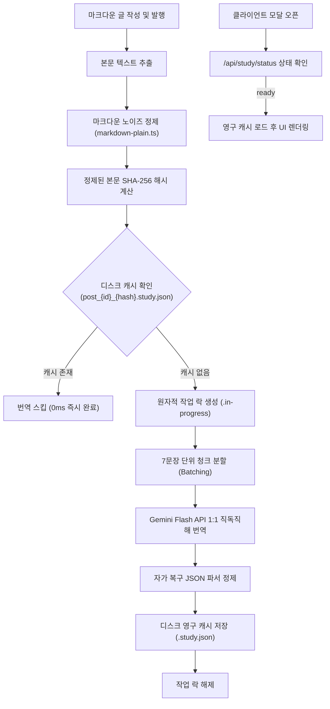

# 문서 01: 영한 대조 학습 및 백그라운드 번역 파이프라인

본 문서는 한국어로 작성된 마크다운 문서를 문장 단위로 분할하여 영어로 1:1 대조 번역하고, 비동기 디스크 캐시로 관리하는 파이프라인 아키텍처를 다룹니다.

---

## 1. 파이프라인 설계 원칙

1. **사용자 인터랙션 무지연 (Zero-Wait User Flow)**:
   사용자가 글을 발행(Publish)하거나 수정하는 시점에 백그라운드 워커가 번역을 미리 완료합니다. 사용자가 모달을 열었을 때는 이미 번역된 결과를 즉시 렌더링합니다.
2. **토큰 소모 제로화 (Permanent Zero-Token Cache)**:
   정제된 본문의 SHA-256 해시를 식별자로 삼아 디스크 파일(`.study.json`)로 영구 보관합니다. 동일한 본문 요청 시 LLM API를 다시 호출하지 않습니다.
3. **콘텐츠 변경 자동 추적 (Hash Invalidation)**:
   본문이 1글자라도 수정되면 해시가 즉시 변경되므로, 구버전 캐시를 참조하지 않고 수정된 본문에 맞춰 백그라운드 워커가 자동으로 새 번역을 수행합니다.
4. **원자적 작업 락 (Atomic Lock)**:
   동일한 글에 중복 요청이 유입되더라도 임시 락 파일(`.in-progress`)을 이용해 LLM 중복 호출과 리소스 낭비를 차단합니다.

---

## 2. 전체 데이터 파이프라인 구조



---

## 3. 핵심 구성 모듈

### A. 마크다운 노이즈 필터링 (`markdown-plain.ts`)
자연스러운 음성 섀도잉 학습을 위해, 발화 대상이 아닌 개발 코드와 서식을 원천 배제합니다:
* 펜스드 코드 블록(```, ~~~) 및 인라인 코드(`) 제거
* 쉘 명령어(`npm`, `git`, `curl`, `pm2`, `docker` 등) 소거
* 프로그래밍 키워드(`import`, `const`, `function`, `class`, `return` 등) 필터링
* URL 링크(`https://...`) 및 로컬 파일 경로 제거
* YAML/TOML 프론트매터 제거 후 순수 서술형 줄글만 추출

### B. 청크 분할 및 안전 파서 (`study-pipeline.ts`)
* **7문장 청크 배치**:
  긴 문서를 한 번에 전송할 때 발생하는 LLM 응답 절단(Truncation)을 막기 위해 본문을 7문장 단위로 묶어 순차 처리합니다.
* **자가 복구 파서**:
  LLM 응답에 마크다운 백틱(` ```json `)이나 앞뒤 설명 문구가 포함되어 있어도, 정규식을 이용해 순수 JSON 배열만 추출하는 방어 로직을 적용했습니다.

### C. 영구 캐시 매니저 (`study-cache.ts`)
* **저장 위치**: `data/study_cache/`
* **파일 명명 규칙**: `post_{postId}_{hash24}.study.json`
* **비정상 락 자동 회수**:
  서버 재시작이나 예외 발생으로 프로세스가 중단되어도, 생성 후 3분이 지난 `.in-progress` 파일은 자동으로 만료 처리하여 영구 교착(Deadlock) 상태를 방지합니다.

---

## 4. 백엔드 엔드포인트 연동 명세

| 엔드포인트 | 메소드 | 주요 역할 |
| :--- | :--- | :--- |
| `/api/study/status` | POST | 현재 글의 번역 상태(`ready`, `processing`, `idle`) 및 문장 수 반환 |
| `/api/study/translate` | POST | 1:1 문장 정합 번역 실행 및 캐시 데이터 응답 |
| `/api/posts/[id]/publish` | POST | 글 발행 시 비동기 번역 워커 자동 가동 |
| `/api/posts/[id]` | PUT | 글 본문 수정 감지 시 변경된 해시로 새 번역 비동기 트리거 |
