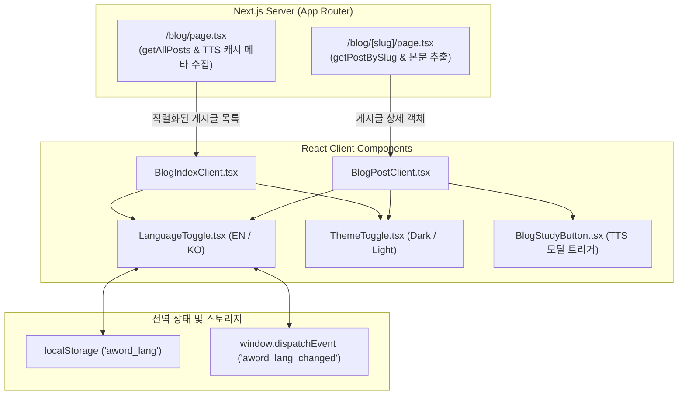

# 문서 04: 블로그 시스템 및 다국어(I18n) 동기화 아키텍처

본 문서는 Next.js 14 App Router 환경에서 블로그 게시글 피드와 상세 페이지를 구성하고, 에디터와 블로그 간 언어 설정을 실시간 동기화하는 구조를 설명합니다.

---

## 1. 아키텍처 개요

블로그는 정적/서버 렌더링의 검색 엔진 최적화(SEO) 이점과 클라이언트 인터랙션(언어 전환, 테마 변경, TTS 모달 연동)의 유연성을 동시에 확보하기 위해 **서버 데이터 페칭 + 클라이언트 뷰 렌더링** 구조로 분리했습니다.

---

## 2. 언어 동기화 엔진 (`useLanguage.ts`)

에디터(`/`)와 블로그(`/blog`, `/blog/[slug]`)가 별도의 라우트로 분리되어 있어도 사용자가 선택한 언어 모드(`ko` 또는 `en`)가 즉각 공유되도록 브라우저 이벤트 버스를 구성했습니다.

### 동기화 메커니즘
1. **로컬 스토리지 영속화**: 사용자가 `EN / KO` 버튼을 누르면 `localStorage.setItem('aword_lang', nextLang)`에 저장합니다.
2. **커스텀 이벤트 브로드캐스트**: `window.dispatchEvent(new CustomEvent('aword_lang_changed', { detail: nextLang }))`를 호출하여 현재 페이지에 마운트된 모든 언어 구독 컴포넌트를 즉각 갱신합니다.
3. **Storage 이벤트 청취**: 다른 브라우저 탭에서 언어가 바뀌었을 때도 `storage` 이벤트를 감지하여 자동으로 맞춰줍니다.

---

## 3. 다국어 사전 체계 (`i18n.ts`)

블로그의 모든 고정 UI 문구를 `i18n.ts` 사전에 등록하여 런타임에 자연스럽게 번역되도록 구현했습니다:

| 키 | 한국어 (`ko`) | 영어 (`en`) |
| :--- | :--- | :--- |
| `blog.backToEditor` | 에디터로 돌아가기 | Back to Editor |
| `blog.allWritings` | 전체 글 목록 | All Writings |
| `blog.title` | 발행된 글 목록 | Published Writings |
| `blog.subtitle` | aWord에서 집중하여 집필하고 발행한 에세이와 기술 글입니다. | Thoughts, essays, and stories composed distraction-free in aWord. |
| `blog.minRead` | 분 읽기 | min read |
| `blog.ttsCached` | TTS 캐시 완료 | TTS Cached |
| `blog.ttsNotCached` | TTS 미생성 | TTS Not Generated |
| `blog.studyBtn` | 영어 학습 & TTS | Study & TTS |

---

## 4. 메타데이터 바 배지 배치 및 가독성 개선

* **문제점**:
  게시글 카드 제목 위에 큰 TTS 캐시 배지가 위치하면서 시선이 분산되고 글 제목 본연의 타이포그래피 가독성이 저하되었습니다.
* **개선책**:
  TTS 준비 완료 상태 배지를 카드 하단의 날짜, 읽기 시간, 태그가 있는 **메타데이터 바 우측**으로 단정하게 재배치했습니다. 제목이 한눈에 들어오면서도 학습 준비 여부를 명확히 파악할 수 있도록 정돈했습니다.
