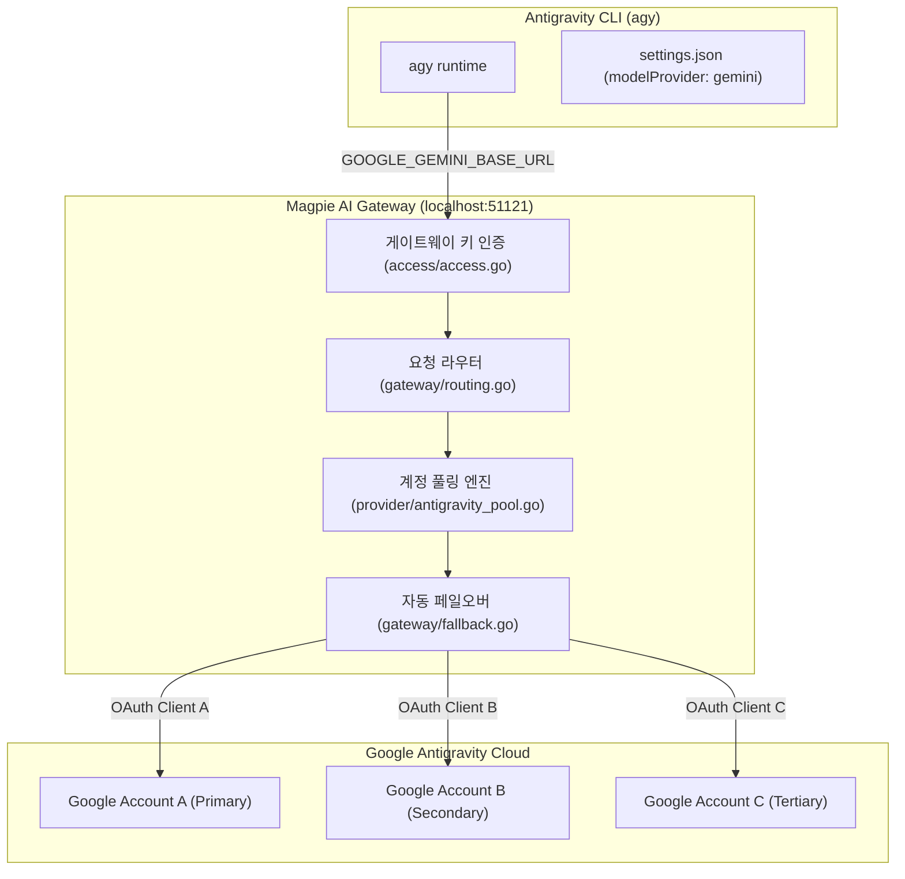

# 문서 06: Antigravity CLI 다중 계정 분기 및 게이트웨이 통합 아키텍처

* **작성 일자**: 2026-10-31
* **분류**: AI 도구 인프라 / 게이트웨이 프록시 / 인증 라우팅
* **관련 프로젝트**: Google Antigravity CLI (`agy`), Magpie Gateway (`krazyeom/magpie`)

---

## 1. 아키텍처 배경 및 문제 정의

Google의 공식 AI 개발 인터페이스인 **Antigravity CLI(`agy`)**는 빠른 코드 분석과 에이전트 실행을 지원하지만, 인증 및 계정 관리 관점에서 다음과 같은 구조적 제약이 존재합니다:

1. **단일 키체인 바인딩**:
   - `agy`는 기동 시 OS 보안 저장소(macOS Keychain, Linux Secret Service, Windows Credential Manager)의 특정 고정 식별자에 단일 OAuth 리프레시 토큰만 보관합니다.
2. **다중 프로필 전환 불가**:
   - `gcloud config configurations`나 `aws --profile`처럼 CLI 명령어나 인자를 통해 다른 계정으로 즉시 전환할 수 있는 프로필 시스템이 없습니다.
3. **할당량(Quota) 분산 필요성**:
   - 복수의 개발 계정(예: Google AI Pro, Starter, Enterprise 등)을 보유한 엔지니어의 경우, 한 계정의 분당 요청 한도(RPM)나 일일 할당량이 소진되었을 때 다른 계정으로 매끄럽게 전환하여 작업 연속성을 유지해야 합니다.

이를 해결하기 위해 로컬 AI 라우터/게이트웨이인 **Magpie**를 중계 계층(Proxy Layer)으로 배치하는 아키텍처를 채택했습니다.

---

## 2. 전체 시스템 구조도



---

## 3. 핵심 모듈별 동작 원리

### 3.1 Antigravity 커스텀 엔드포인트 탈취
Antigravity CLI는 `~/.gemini/antigravity-cli/settings.json` 설정에 따라 Gemini API 호환 외부 엔드포인트로 통신 대상을 변경할 수 있습니다:
* `modelProvider`: `"gemini"`로 지정
* `customModelsConfig.customModels`: Magpie가 노출하는 카탈로그 모델을 등록
* 환경변수 주입:
  * `GOOGLE_GEMINI_BASE_URL`: Magpie 로컬 게이트웨이 주소 (`http://127.0.0.1:51121`)
  * `GEMINI_API_KEY`: Magpie 게이트웨이 접근 토큰

### 3.2 계정 풀링 및 통합 모델 제공 (`antigravity_pool.go`)
Antigravity는 계정 등급이나 롤아웃 시점에 따라 활성화된 모델 목록이 다를 수 있습니다. Magpie는 등록된 모든 활성 계정(`On: true`)의 모델 목록을 병합하여 상위 합집합 카탈로그를 생성합니다:
```go
// antigravityPoolModels 병합 의사코드
func antigravityPoolModels(ctx context.Context) ([]catalog.Model, error) {
    // 1. 활성화된 모든 Google Antigravity 계정 조회
    // 2. 계정별 가용 모델 병렬 조회 (최대 4슬롯 동시성)
    // 3. 모델 목록 계정 순서 기반 병합 (mergeAntigravityModels)
    // 4. 통합 카탈로그 저장 및 반환
}
```

### 3.3 지능형 장애조치 및 라운드로빈 (`fallback.go`)
요청 처리 중 기본 계정에서 429(Quota Exceeded) 또는 리소스 고갈 응답이 반환되면 게이트웨이가 즉시 차순위 계정 후보(`candidate`)로 요청을 재전송합니다:
* 기본 계정 일시 휴식(`Resting`) 마킹
* 활성 계정 리스트(`AlsoOn()`)에서 가용 계정 탐색
* 클라이언트 재시도 없이 동일 HTTP 스트림 내에서 즉각 복구

---

## 4. 실무 운용 도구: `agyp` (`agy-pool`)

다중 계정 풀링과 수동 계정 선택을 원클릭으로 결합한 통합 CLI 도구 `agyp`([~/.local/bin/agyp](file:///Users/krazyeom/.local/bin/agyp))를 구현 및 배포했습니다:

### 4.1 기본 실행 (자동 Failover 풀링)
```bash
# 등록된 모든 계정의 쿼터를 하나로 묶어 자동 페일오버로 실행
agyp

# 단일 프롬프트 실행 및 옵션 전달
agyp -p "코드베이스 구조 분석해줘"
```

### 4.2 수동 계정 선택 실행
```bash
# 특정 계정(이메일 또는 별칭)을 1순위로 지정하여 실행
agyp -a work@example.com

# 또는
agyp --account work@example.com
```

### 4.3 계정 풀 관리 서브커맨드
```bash
# 계정 목록 및 실시간 쿼터 확인
agyp list

# 새로운 구글 계정 간편 추가 (브라우저 OAuth)
agyp add

# 기본 1순위 계정 변경
agyp switch sub@example.com

# 게이트웨이 및 풀링 연결 상태 점검
agyp status
```

---

## 5. 실무 운용 전략 상세

### 전략 1: 쿼터 통합 풀링 모드 (권장: 일반 개발용)
모든 계정을 등록해두고 쿼터를 최대로 활용하는 방식입니다.
```bash
# 1. 계정 등록
agyp add

# 2. 계정 순서 및 상태 확인
agyp list

# 3. 필요 시 1순위 계정 전환
agyp switch primary@example.com
```

### 전략 2: 계정 완전 격리 모드 (권장: 업무/개인 분리)
특정 계정에만 트래픽이 가도록 게이트웨이 키를 생성하고 전용 alias를 구성합니다.
```bash
# 1. 계정별 게이트웨이 키 발급 및 바인딩
magpie gateway-key add agy-work
magpie gateway-key accounts agy-work antigravity/work@example.com

magpie gateway-key add agy-personal
magpie gateway-key accounts agy-personal antigravity/personal@example.com

# 2. 셸 프로필(~/.zshrc 등)에 전용 명령어 등록
alias agy-work='GEMINI_API_KEY="<work-key>" GOOGLE_GEMINI_BASE_URL="http://127.0.0.1:3425" agy'
alias agy-personal='GEMINI_API_KEY="<personal-key>" GOOGLE_GEMINI_BASE_URL="http://127.0.0.1:3425" agy'
```

---

## 6. 구현 및 배포 내역 (Implementation Status)

1. **Magpie 앱 GUI 계정 스위칭 및 설정 서랍 연동 완료**:
   * `internal/gui/assets/app.js`: 미연결 상태의 `agy` 행에 계정 스위처 버튼(`.ag-acc.ag-who`) 배치 및 팝업 메뉴를 통한 원클릭 계정 전환 제공.
   * `internal/agent/agy.go`: `account` 필드를 등록하여 에이전트 상세 서랍에서 계정 풀 목록을 드롭다운으로 선택 가능하도록 구현.
2. **macOS 시스템 키체인(`Keychain`) 원자적 갱신 연동**:
   * `internal/provider/google.go`: `SwitchLogin("antigravity", user)` 호출 시 Magpie `logins.json`뿐만 아니라 macOS Keychain(`service: gemini, account: antigravity`)의 OAuth 토큰(`go-keyring-base64:<json>`)을 동기화하도록 구현.
   * Magpie 게이트웨이 경유 실행과 `agy` 단독 실행 양쪽 모두에서 계정이 즉시 반영됨.
3. **독립 버전 태깅 및 커스텀 메타데이터 노출**:
   * Settings › About 페이지에 `Custom build` 행 추가 (유지보수자 `krazyeom`, 저장소 `krazyeom/magpie` 직결 GitHub 링크).
   * `v0.1.2374-krazyeom.1` 태그 생성 및 `internal/update/update.go` 업스트림 덮어쓰기 방지 적용.
4. **바이너리 빌드 및 macOS 앱 번들 배포**:
   * `make build` 및 `make app` 빌드 검증 통과, `/Applications/magpie.app` 설치 및 실행 프로세스 갱신 완료.

---

## 7. Magpie GUI 조작 매뉴얼 (User Manual for GUI)

사용자는 Magpie GUI 앱에서 세 가지 직관적인 경로로 Antigravity 계정을 전환할 수 있습니다:

```
[Magpie App GUI 계정 전환 경로 3가지]
┌────────────────────────────────────────────────────────────────────────┐
│ 1. Agents 탭: Antigravity CLI 행 우측 [● account@gmail.com] 뱃지 클릭  │
│    └─ 드롭다운 팝업에서 다른 계정 클릭 시 즉시 전환                    │
├────────────────────────────────────────────────────────────────────────┤
│ 2. Agents 상세 서랍: Antigravity CLI 행 클릭 후 [Account] 드롭다운     │
│    └─ 등록된 계정 풀 목록 중 원하는 계정 선택                          │
├────────────────────────────────────────────────────────────────────────┤
│ 3. Providers 탭: [Antigravity] 카드에서 잔여 쿼터 확인 후              │
│    └─ 원하는 계정의 [Make first] 버튼 클릭하여 1순위 승격              │
└────────────────────────────────────────────────────────────────────────┘
```

1. **Agents 탭 (에이전트 목록 빠른 스위처)**:
   * 상단 **Agents** 탭에서 `Antigravity CLI` 항목을 찾습니다.
   * 이름 우측의 계정 뱃지(`.ag-acc.ag-who`, 예: `● user@gmail.com`)를 클릭하면 팝업 드롭다운이 열립니다.
   * 원하는 계정을 클릭하면 즉시 주 계정이 전환되고 macOS 키체인이 동기화됩니다.
2. **Agents 상세 설정 서랍**:
   * `Antigravity CLI` 행을 클릭하여 열리는 서랍 내 **`Account`** 필드 드롭다운에서 계정을 선택합니다.
3. **Providers 탭 (쿼터 모니터링 및 지정)**:
   * 상단 **Providers** 탭의 `Antigravity` 카드에서 계정별 실시간 잔여 쿼터(`Gemini 7d`, `Claude & GPT` 등)를 확인하고, **`Make first`** 버튼을 눌러 1순위 계정으로 승격시킵니다.

---

## 8. 커스텀 빌드 메타데이터 및 버전 관리 사양서

| 항목 | 구현 위치 | 동작 내용 |
| :--- | :--- | :--- |
| **Settings › About 노출** | `internal/gui/assets/app.js` | `Custom build` 행 신설, `krazyeom` 유지보수자 및 `github.com/krazyeom/magpie` GitHub 바로가기 연동 |
| **버전 상태 문구** | `internal/gui/assets/app.js` | Version 행 세부 상태에 `Custom build by krazyeom` 표시 |
| **다국어 지원** | `internal/gui/assets/i18n.js` | 한국어/영어/중국어/일본어/독어 로케일에 커스텀 빌드 레이블 등록 |
| **macOS 번들 저작권** | `build/darwin/Info.plist` | `NSHumanReadableCopyright`에 `krazyeom (forked from yetone)` 명시 |
| **빌드 버전 자동 부여** | `Makefile` | `VERSION` 생성 시 `*-krazyeom*` 태그 우선 감지 및 `-krazyeom` 자동 접미사 부여 |
| **업스트림 덮어쓰기 방어** | `internal/update/update.go` | `Released(v)`에서 `krazyeom` 포함 시 `false` 반환하여 업스트림 자동 업데이트 차단 |

---

## 9. 소스코드 구조 및 참조 파일 맵

* **[internal/agent/agy.go](file:///Users/krazyeom/dev/magpie/internal/agent/agy.go)**: Antigravity CLI 에이전트 정의 및 `Account` 설정 필드
* **[internal/provider/google.go](file:///Users/krazyeom/dev/magpie/internal/provider/google.go)**: Google Antigravity 인증, 계정 감지 및 macOS 키체인 동기화(`syncAntigravityKeychain`)
* **[internal/provider/logins.go](file:///Users/krazyeom/dev/magpie/internal/provider/logins.go)**: 계정 목록 조회, 1순위 계정 확인 및 전환 처리
* **[internal/gui/assets/app.js](file:///Users/krazyeom/dev/magpie/internal/gui/assets/app.js)**: GUI 계정 스위처 렌더링 및 About 페이지 메타데이터
* **[internal/update/update.go](file:///Users/krazyeom/dev/magpie/internal/update/update.go)**: 업데이트 릴리즈 판별 및 커스텀 빌드 보호
* **[docs/antigravity-guide.md](file:///Users/krazyeom/dev/magpie/docs/antigravity-guide.md)**: Magpie 저장소 내 사용자 매뉴얼 및 시스템 기술문서
