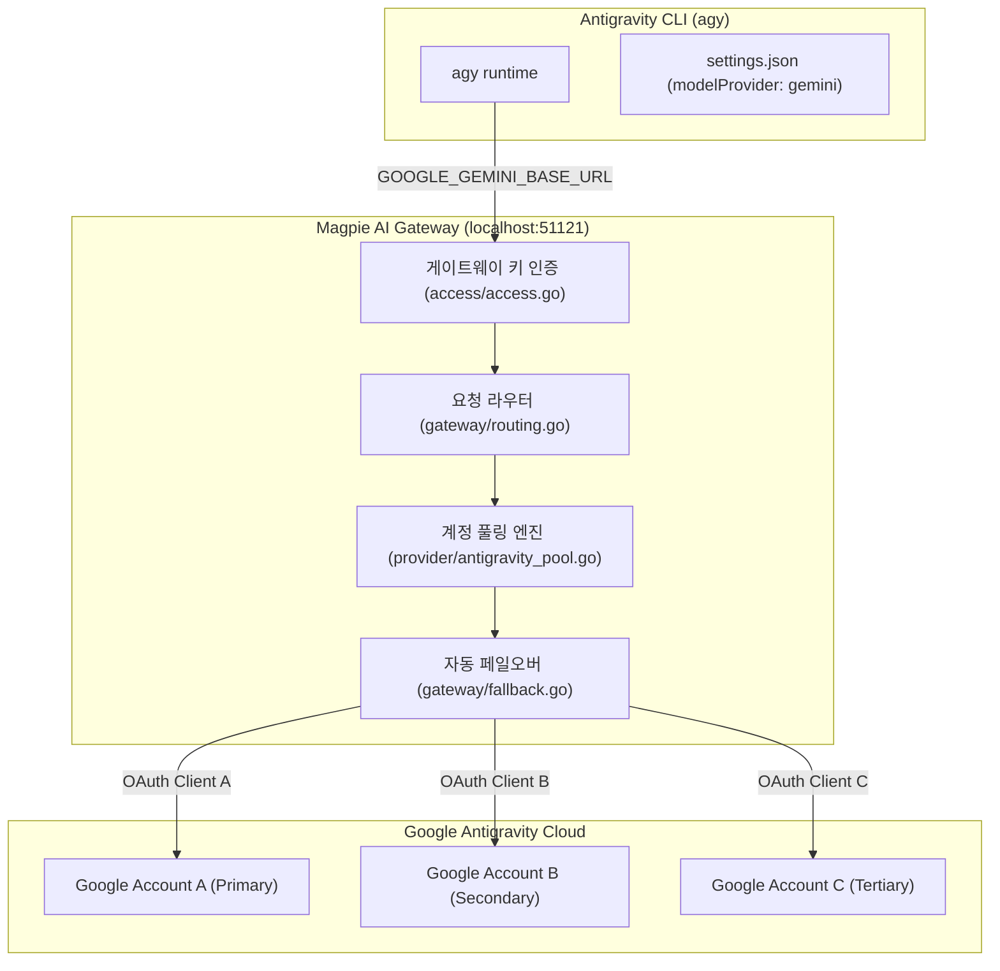

# 문서 06: Antigravity CLI 다중 계정 분기 및 게이트웨이 통합 아키텍처

* **작성 일자**: 2026-10-31
* **분류**: AI 도구 인프라 / 게이트웨이 프록시 / 인증 라우팅
* **관련 프로젝트**: Google Antigravity CLI (`agy`), Magpie Gateway (`krazyeom/magpie`)

---

## 1. 아키텍처 배경 및 문제 정의

Google의 공식 AI 개발 인터페이스인 **Antigravity CLI(`agy`)**는 빠른 코드 분석과 에이전트 실행을 지원하지만, 인증 및 계정 관리 관점에서 다음과 같은 구조적 제약이 존재합니다:

1. **단일 키체인 바인딩**:
   - `agy`는 기동 시 OS 보안 저장소(macOS Keychain, Linux Secret Service, Windows Credential Manager)의 특정 고정 식별자에 단일 OAuth 리프레시 토큰만 보관합니다.
2. **다중 프로필 전환 불가**:
   - `gcloud config configurations`나 `aws --profile`처럼 CLI 명령어나 인자를 통해 다른 계정으로 즉시 전환할 수 있는 프로필 시스템이 없습니다.
3. **할당량(Quota) 분산 필요성**:
   - 복수의 개발 계정(예: Google AI Pro, Starter, Enterprise 등)을 보유한 엔지니어의 경우, 한 계정의 분당 요청 한도(RPM)나 일일 할당량이 소진되었을 때 다른 계정으로 매끄럽게 전환하여 작업 연속성을 유지해야 합니다.

이를 해결하기 위해 로컬 AI 라우터/게이트웨이인 **Magpie**를 중계 계층(Proxy Layer)으로 배치하는 아키텍처를 채택했습니다.

---

## 2. 전체 시스템 구조도



---

## 3. 핵심 모듈별 동작 원리

### 3.1 Antigravity 커스텀 엔드포인트 탈취
Antigravity CLI는 `~/.gemini/antigravity-cli/settings.json` 설정에 따라 Gemini API 호환 외부 엔드포인트로 통신 대상을 변경할 수 있습니다:
* `modelProvider`: `"gemini"`로 지정
* `customModelsConfig.customModels`: Magpie가 노출하는 카탈로그 모델을 등록
* 환경변수 주입:
  * `GOOGLE_GEMINI_BASE_URL`: Magpie 로컬 게이트웨이 주소 (`http://127.0.0.1:51121`)
  * `GEMINI_API_KEY`: Magpie 게이트웨이 접근 토큰

### 3.2 계정 풀링 및 통합 모델 제공 (`antigravity_pool.go`)
Antigravity는 계정 등급이나 롤아웃 시점에 따라 활성화된 모델 목록이 다를 수 있습니다. Magpie는 등록된 모든 활성 계정(`On: true`)의 모델 목록을 병합하여 상위 합집합 카탈로그를 생성합니다:
```go
// antigravityPoolModels 병합 의사코드
func antigravityPoolModels(ctx context.Context) ([]catalog.Model, error) {
    // 1. 활성화된 모든 Google Antigravity 계정 조회
    // 2. 계정별 가용 모델 병렬 조회 (최대 4슬롯 동시성)
    // 3. 모델 목록 계정 순서 기반 병합 (mergeAntigravityModels)
    // 4. 통합 카탈로그 저장 및 반환
}
```

### 3.3 지능형 장애조치 및 라운드로빈 (`fallback.go`)
요청 처리 중 기본 계정에서 429(Quota Exceeded) 또는 리소스 고갈 응답이 반환되면 게이트웨이가 즉시 차순위 계정 후보(`candidate`)로 요청을 재전송합니다:
* 기본 계정 일시 휴식(`Resting`) 마킹
* 활성 계정 리스트(`AlsoOn()`)에서 가용 계정 탐색
* 클라이언트 재시도 없이 동일 HTTP 스트림 내에서 즉각 복구

---

## 4. 실무 운용 전략

### 전략 1: 쿼터 통합 풀링 모드 (권장: 일반 개발용)
모든 계정을 등록해두고 쿼터를 최대로 활용하는 방식입니다.
```bash
# 1. 계정 등록
magpie accounts add antigravity

# 2. 계정 순서 및 상태 확인
magpie accounts antigravity

# 3. 필요 시 1순위 계정 전환
magpie accounts switch antigravity primary@example.com
```

### 전략 2: 계정 완전 격리 모드 (권장: 업무/개인 분리)
특정 계정에만 트래픽이 가도록 게이트웨이 키를 생성하고 전용 alias를 구성합니다.
```bash
# 1. 계정별 게이트웨이 키 발급 및 바인딩
magpie gateway-key add agy-work
magpie gateway-key accounts agy-work antigravity/work@example.com

magpie gateway-key add agy-personal
magpie gateway-key accounts agy-personal antigravity/personal@example.com

# 2. 셸 프로필(~/.zshrc 등)에 전용 명령어 등록
alias agy-work='GEMINI_API_KEY="<work-key>" GOOGLE_GEMINI_BASE_URL="http://127.0.0.1:51121" agy'
alias agy-personal='GEMINI_API_KEY="<personal-key>" GOOGLE_GEMINI_BASE_URL="http://127.0.0.1:51121" agy'
```

---

## 5. 향후 확장 고려 사항 (Feature Backlog)

1. **`magpie agy` CLI 계정 플래그 지원**:
   - `magpie agy run --account <email>` 인자를 파싱하여 지정 계정 전용 임시 키를 자동 주입하는 편의 기능.
2. **Magpie Web UI의 Antigravity CLI 설정 개선**:
   - Aside 에이전트(`internal/agent/aside.go`)의 `account` 필드처럼, Web UI 상에서 `agy`가 기본 사용할 계정을 드롭다운으로 선택할 수 있도록 필드 확장.
